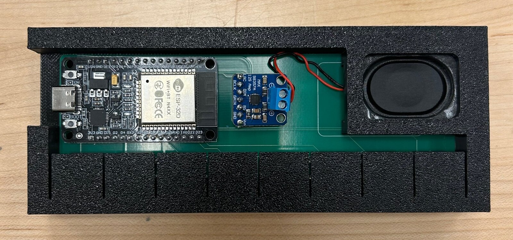
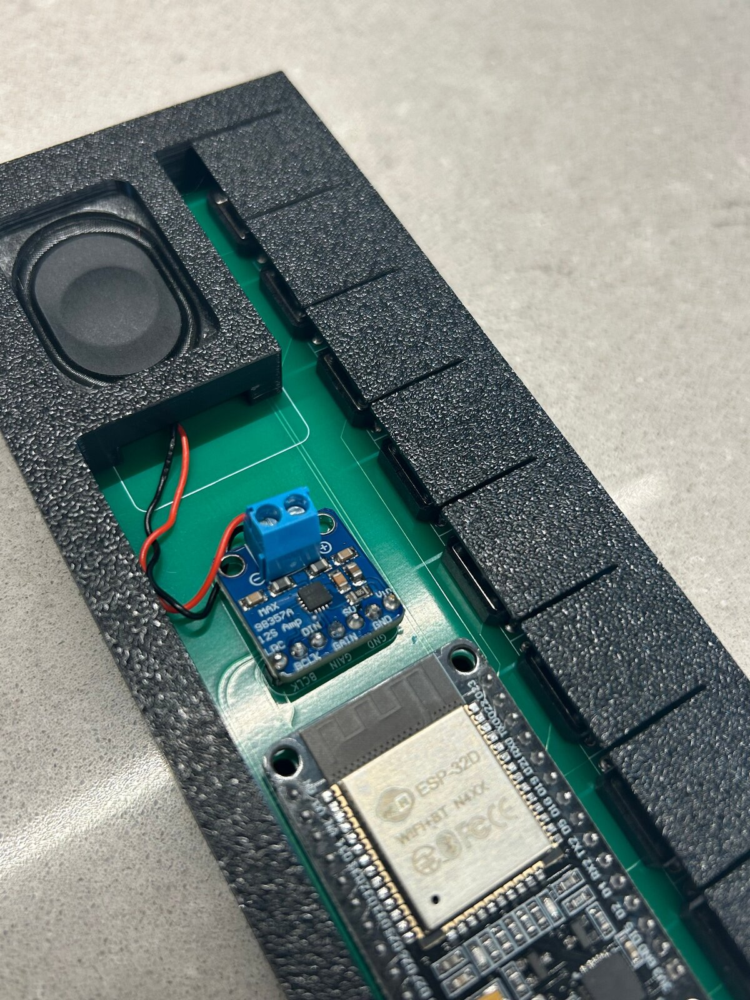

# Mini Soundboard

An 8-button, ESP32-powered soundboard. A custom PCB, a 3D-printed enclosure, and digital I²S audio. Each button plays its own sound clip, and you can change the sounds at any time by uploading new WAV files to the ESP32's flash. You don't need to touch the code to do it.



## Features

- **Custom PCB.** Eight tactile switches, the ESP32 dev board, and the audio amplifier are all soldered to one board.
- **ESP32-WROOM-32D.** Runs the firmware, reads the buttons, and streams audio over I²S.
- **MAX98357A I²S Class-D amplifier.** Turns the ESP32's digital audio stream straight into speaker output. No separate DAC and the analog signal path is short.
- **Mini speaker.** Sits in its own pocket in the case.
- **3D-printed enclosure.** Holds the PCB, has integrated key caps for all 8 buttons, and leaves the USB-C port open for power and programming.
- **Swappable sounds.** The clips are stored on the ESP32's flash using LittleFS. To change a sound, replace a WAV file and upload the filesystem again.



## Hardware

| Part | Notes |
|---|---|
| ESP32-WROOM-32D dev board | USB-C, CP2102 USB-to-UART bridge |
| MAX98357A I²S amplifier breakout | Class-D, mono |
| Mini speaker | Connects to the amp's screw terminal |
| 8× tactile switches | Active-low, using the ESP32's internal pull-ups |
| Custom PCB + 3D-printed case |

### Pin map

| Signal | ESP32 GPIO |
|---|---|
| I²S LRC (word select) | 14 |
| I²S BCLK | 25 |
| I²S DIN | 32 |
| Amp GAIN | 27 |
| Buttons 1–8 | 13, 4, 18, 19, 22, 23, 26, 33 |

## Repository layout

```
CustomSoundboard/
├── CustomSoundboard.ino   # firmware
└── data/                  # sound clips uploaded to LittleFS
    ├── sound1.wav         # Button 1
    ├── ...
    └── sound8.wav         # Button 8
images/                    # photos for this README
```

## Getting started

### 1. Set up Arduino IDE 2.x

1. **File → Preferences → Additional boards manager URLs**, then add:
   `https://espressif.github.io/arduino-esp32/package_esp32_index.json`
2. **Boards Manager**: install **esp32 by Espressif Systems**.
3. Install the [arduino-littlefs-upload](https://github.com/earlephilhower/arduino-littlefs-upload) plugin by placing the `.vsix` in `~/.arduinoIDE/plugins/`.
4. If Windows doesn't show a COM port for the board, install the [Silicon Labs CP210x driver](https://www.silabs.com/developers/usb-to-uart-bridge-vcp-drivers).

### 2. Board settings

| Setting | Value |
|---|---|
| Board | ESP32 Dev Module |
| Partition Scheme | Default 4MB with spiffs (1.2MB APP / 1.5MB SPIFFS) |
| Port | Your board's COM port |

### 3. Upload

1. Open `CustomSoundboard/CustomSoundboard.ino` and click **Upload**.
2. Close the Serial Monitor, then press **Ctrl+Shift+P → Upload LittleFS to Pico/ESP8266/ESP32**.
3. Press **EN/RST** on the board, then press a button.

If an upload gets stuck at `Connecting...`, hold **BOOT** until writing starts.

## Changing the sounds

Replace any file in `CustomSoundboard/data/` with one that has the **same name** (`sound1.wav` … `sound8.wav`), then run **Upload LittleFS** again. You don't need to upload the sketch again.

The firmware plays only this exact format and skips any other file:

| Property | Required |
|---|---|
| Sample rate | **22,050 Hz** |
| Encoding | **Signed 16-bit PCM** |
| Channels | **Mono** |

To convert a file with [ffmpeg](https://ffmpeg.org/):

```bash
ffmpeg -i input.mp3 -ar 22050 -ac 1 -c:a pcm_s16le sound1.wav
```

In Audacity: set the project rate to 22050, use **Tracks → Mix → Mix Stereo Down to Mono**, then export as **WAV, Signed 16-bit PCM**.

The filesystem partition holds about 1.3 MB. That's about 30 seconds of audio shared across all 8 buttons.

### Volume

Edit `VOLUME` in the sketch. It defaults to `0.20`, and 0.15–0.40 is a good range. Upload the sketch again after changing it.

## Troubleshooting

Open the Serial Monitor at **115200 baud** and press EN/RST.

| Serial output | Fix |
|---|---|
| `LittleFS mount failed!` | Run **Upload LittleFS**, using the same partition scheme as the sketch. |
| `Missing file: /soundX.wav` | Check the filename in `data/`. Windows can hide a double `.wav.wav` extension. |
| `Unsupported WAV: /soundX.wav` | Convert the file to 22,050 Hz, mono, 16-bit PCM. |
| `Playing: ...` but no sound | Check the I²S wiring, the speaker terminal, and the amp's power and ground. |
